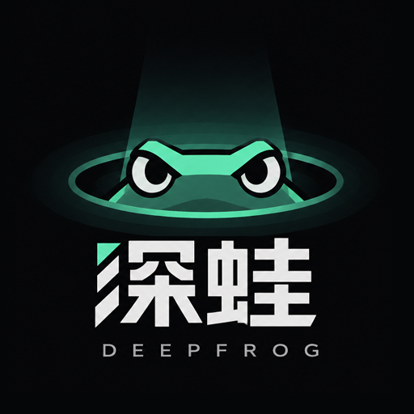

<div align="center">



# 深蛙 · Deep Frog

> **凡是要下注的问题，先把证据收拾干净。**
> *Before you bet on an answer, get the evidence straight.*

[](skill/LICENSE)
[](skill/SKILL.md)

**Version** `1.0.0` · **Author** [GTC-BlackAries](https://github.com/GTC-BlackAries) · **License** MIT\*
<sub>\*Bundled fonts under `skill/fonts/` are separately licensed under SIL OFL 1.1, see [FONT-LICENSE.md](skill/fonts/FONT-LICENSE.md).</sub>

</div>

---

## ⏱️ 跑之前要知道的成本 · Cost up front

**深蛙把单个话题挖得比较深，一次完整调研约需 30–60 分钟，token 消耗较大。** 实测参考：本仓库 [`examples/`](examples/) 里的「社区电子产品回收」案例，在 WorkBuddy Hy4 模型上跑了约 **40 分钟**，产出 13 章自包含 HTML 档案 + 独立 critic 挑刺记录 + 40 条逐一人复核的审计警告。

**不是每个问题都值得动用深蛙。** 它按决策分量自动分档（见下），小事实直接搜索就够——深蛙不应为了显得严谨而让每个问题都走完整流程。

> A full run goes deep on one topic — typically **30–60 minutes with substantial token usage** (the example dossier took ~40 min on WorkBuddy Hy4). Don't use it for quick lookups; it self-tiers by decision weight.

## 这是什么 · What it is

深蛙是一套**可复用的研究纪律与任务编排 skill（元技能）**：不绑定行业，把"要不要投入 / 要不要信 / 要不要买或签"这类要下注的问题，组织成有边界、有证据、有核验、明确呈现未知项的研究任务。领域知识随任务加载，纪律永不加载。

名字取自"深挖"的谐音——而且**蛙会叫**：查不到、有冲突、拿不准时必须出声。一只闷头挖、什么都不吭声的鼹鼠，恰恰是调研最怕的样子。

**English**: Deep Frog is a domain-agnostic research-discipline and orchestration skill. It turns bet-worthy questions into scoped research tasks with traceable evidence and explicit unknowns. The name puns on "deep dive"; the frog also *croaks* — gaps, conflicts, and uncertainties are announced, never buried.

> 核心定位：不是让 AI 更快给出答案，而是让答案背后的依据更清楚。
> *Not a faster answer — an inspectable one.*

## 四条不可协商的纪律 · Four non-negotiable rules

| # | 中文 | English |
|---|---|---|
| 1 | **口径先于数字**：数字必带统计方法/年份/样本量/零售还是出厂。没口径的数字不许写进正文 | **Caliber before figure**: every number carries its statistical caliber. No caliber, no body text |
| 2 | **冲突不调和**：来源打架就并列摆出，不挑顺眼的、不取平均、不写"约"。打架本身就是信息 | **Never reconcile conflicts**: clashing sources stay side by side with calibers. The clash is information |
| 3 | **查不到就写查不到**：列入"未解缺口"，绝不用估算填。缺一个数字，比错一个数字安全 | **Say "not found"**: gaps are listed, never filled with estimates. A missing number is safer than a wrong one |
| 4 | **冲突必须先问人**：结论与用户已知事实打架时停下来问，绝不静默改掉用户的基准；核验器自身故障记 `UNVERIFIABLE`，不记"已证伪" | **Conflicts go to the human first**: never silently overwrite the user's baseline; a crashed verifier yields *unverifiable*, not *refuted* |

## 怎么路由：意图 × 分量 · Routing: intent × weight

**按决策意图**分三条内部路径（不是三个独立 skill）：

| 路径 | 你在问什么 | 典型交付 |
|---|---|---|
| 决策型调研 | 这个赛道/方向值得投入吗 | 完整 HTML 研究档案 |
| 事实核验 | 这个说法/报告/数字是真的吗 | 核验判定 + 原文出处 + 存疑点 |
| 采购与合作尽调 | 该买/续费/签约吗 | 风险清单 + 谈判要点 + 迁移建议 |

**按决策分量**决定投入（自动判断，无需手动选模式）：

| 分量 | 编排 | 交付 |
|---|---|---|
| 高（真要投钱/时间/方向） | 五类证据路径并行 + 主线程对抗核验 + 独立 critic | 自包含 HTML + 双脚本质检 |
| 中（选型/续费/核一个说法） | 聚焦 2–3 路 + 主线程核验 | 对话内结构化答复 |
| 低（有明确答案的小事实） | 直接搜，不启动深蛙 | 简短答复 |

五类证据路径 = 市场需求 / 供给竞争 / 一手依据（随领域调整）/ 政策合规 / 工具形态——价值在**证据类型互补**，不是让多个 agent 重复搜同一批网页。

**没有候选方向时**：深蛙的输入是一个待验证的候选。从零生成候选请用上游 skill **蝌蚪（tadpole）**——一句话记住分工：**蝌蚪让你有东西可判，深蛙判它生死**。蝌蚪不是依赖，没装也照样能验证你已有的候选。

## 证据怎么标注 · How findings are labeled

两套独立标注，别混：**证据等级** A（指南/RCT/官方统计）· B（队列研究/机构口径/企业披露）· C（专家意见/自媒体/宣传）；**结论状态** `CONFIRMED` / `REFUTED` / `UNVERIFIABLE`。A 级来源也可能有局限——等级不是真实性保证，结论仍需按人群、时间、范围解释。

## 真实案例 · A real dossier

[`examples/community-electronics-recycling/`](examples/community-electronics-recycling/) ——「社区电子产品二手回收值不值得进」，40 分钟实跑：

- 流传的"7,000 亿"是流转 GMV 不是社区盘子；"2% 正规回收率"多源旧数据口径互打架
- **单位经济数据（单点月单量/单台毛利/合规成本）全部查不到，报告拒绝用估算填**
- 独立 critic 9 条判定 **5 条 REFUTED**，原文未经删改全部收录；审计 0 ERROR / 40 WARN 逐条人工复核

这就是纪律 3 长出来的样子——**它敢把"不知道"印在交付物上。**

## 能力边界 · Limitations（诚实条款）

1. **研究能力依赖宿主 agent**：联网、读写文件、生成报告由运行环境提供；没有工具就不能假定操作已发生
2. **真并行依赖子 agent 支持**：宿主不支持五路并行时，执行方式和限制会如实披露，不假装做了
3. **证据覆盖受外部条件限制**：付费墙、私有数据、地区限制、网页失效——**没检索到 ≠ 不存在**
4. **自动审计不是事实证明**：`audit_report.py` 是静态结构检查，ERROR 必须清零，WARN 需人工复核；不能替代专业审阅
5. **渲染检查有环境要求**：脚本需 Python 3.8+（仅标准库）并在预设路径找 Edge/Chrome；找不到浏览器就不把渲染检查标成通过，走 `references/04-manual-checklist.md` 人工核对
6. **不替代专业意见**：医疗/法律/金融相关研究只是资料整理，不是诊断、法律意见或投资建议
7. **不擅自修改你的资料**：反哺建议 ≠ 执行授权，改你的文件前必先问你

## 快速开始 · Quick start

**WorkBuddy 用户**：技能市场搜「**深蛙**」安装，然后直接说——

```
帮我深挖一下这个赛道，值不值得进
这个市场规模 80 亿的说法靠谱吗，帮我核一下出处和口径
帮我盘一下我们公司该不该接这个供应商
```

**其他 Agent 环境**：把整个 `skill/` 目录放入你的 skills 路径（如 `~/.workbuddy/skills/deep-frog/`；SKILL.md 为通用格式）。**不要只复制 SKILL.md**——`references/`、`scripts/`、`fonts/` 都是研究规范、质检与样式的一部分。

## 仓库结构 · Layout

```
deep-frog/
├── README.md / REFERENCES.md      # 你在这里 + 来源与原创性声明
├── assets/logo.png
├── examples/community-electronics-recycling/   # 真实调研档案（含 critic 原文、审计输出）
└── skill/                         # ★ skill 本体
    ├── SKILL.md  LICENSE
    ├── references/  (01-04 四份执行规范)
    ├── scripts/     (audit_report.py · render_check.py)
    └── fonts/       (SIL OFL 1.1)
```

## 来源与原创性 · Provenance

本 skill 独立编写，未复制任何现有 skill 的文字、结构模板或代码；纪律从一次真实调研事故倒推而来。公共范式内只主张一处原创（数字带统计口径），其余如实标注为跟随或取舍——全文见 **[REFERENCES.md](REFERENCES.md)**。那份文件本身，就是纪律 2、3 对 README 的用法。

## 许可 · License

主体 [MIT](skill/LICENSE)（© 2026 GTC黑羊 · ToolRadar.cc）；`skill/fonts/` 字体为 SIL Open Font License 1.1。

<div align="center">

**蛙会叫。** · *The frog croaks.*

</div>
